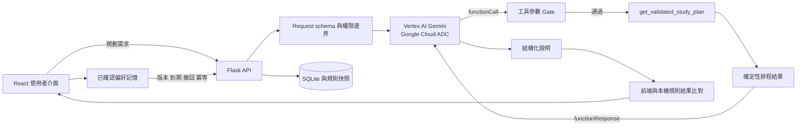

# Making Life at NUTN Better with Agents — 期中報告內容

報告日期：2026-11-04

專題：學生個人安排系統

## 組員

| 姓名 | 學號 | 報告責任 |
| --- | --- | --- |
| 蔣仲鋰 | 待補 | 問題、架構與整合 |
| 張華庭 | 待補 | 智慧學習主流程與工具 |
| 陳苾妏 | 待補 | 畢業進度、測試與失敗案例 |
| 呂安婷 | 待補 | UI 示範、證據與後續計畫 |

上表的報告責任是依目前模組整理的口頭分工建議；個人實際貢獻需由組員在報告前確認，不可用建議取代真實分工紀錄。

## 1. 問題與使用情境

大學生的課表、待辦、私人行程、複習需求與畢業規則分散在不同地方。學生在考試前需要反覆核對空堂與衝突，規劃選課時也容易把「規劃中」誤認成「已取得」，或忽略待確認的規則。

具體情境：學生輸入資料結構考試日期、需要 6 小時複習、每次 2 小時、可使用下午與晚上。系統避開固定課程與社團會議，產生三個複習時段，說明結果並保留人工調整能力。

為什麼需要 Agent：

- 自然語言與工具選擇需要模型處理，說明也要依工具結果整理成使用者可理解的文字。
- 排程、衝突、學分、版本、到期與權限可由一般程式精確判斷，不能交給模型猜測。
- Agent 的價值在於「選用受限工具並整理已驗證結果」，不在於取代規則引擎。

## 2. 系統架構與設計選擇

設計選擇：

- 主流程使用 Google Cloud Vertex AI Gemini，後端透過 ADC 取得短期憑證。瀏覽器不持有金鑰或 token。
- 規則排程是唯一時段結果來源。Gemini 工具參數若與已驗證需求不一致，工具執行次數為 0。
- 唯讀預覽不需人工確認；寫入 `save_study_plan` 必須 `confirmed=true`，並以 `request_id` 保證重送不重複寫入。
- 沒有外部校務知識，因此主排程不使用 RAG。畢業規則使用版本化本機規則快照與來源 ID，未知值保持 `null`。
- 模型、工具或來源驗證失敗時有限停止，保留規則排程或基本畢業進度，再交由使用者決定是否重試。

## 3. 工具介面

| 工具 | 輸入 | 輸出 | 驗證與權限 |
| --- | --- | --- | --- |
| `get_validated_study_plan` | 起始／考試日期、總時數、單次時長、允許時段、課程名、私人行程 | sessions、已安排分鐘、尚缺分鐘 | 固定 schema、日期與時段範圍、工具參數等於原需求、衝突與時數 Gate；唯讀 |
| `save_study_plan` | 已驗證 preview、`confirmed`、`request_id` | saved IDs、status、replayed | 未確認不寫；空 request ID 拒絕；相同 ID 相同 payload 回放，不同 payload 拒絕 |

## 4. 完整示範流程

1. 進入「智慧學習」，確認固定課表與私人行程。
2. 輸入考試日期、6 小時、每次 2 小時、下午與晚上。
3. 前端先顯示確定性排程 fallback。
4. Flask 驗證需求後，Gemini 產生 `get_validated_study_plan` function call。
5. 後端驗證參數與原需求完全一致，執行排程與衝突 Gate。
6. 工具結果用 `functionResponse` 回送 Gemini。
7. 前端顯示結構化說明、來源、模型、工具與 workflow stage。
8. 若 provider 不可用，畫面保留規則排程並顯示失敗原因。

相較最初版本：加入後端憑證邊界、Prompt Chaining trace、參數 Gate、寫入確認與冪等、跨 session 偏好生命週期、畢業說明 A/B 評估及 TTL／來源重驗證。

## 5. 完成狀態

| 狀態 | 功能 |
| --- | --- |
| 已完成並離線驗證 | 課表／待辦／私人行程 UI、確定性複習排程、兩個工具契約、Prompt Chaining Gate、偏好保存／更正／到期／撤回／冪等、畢業進度與說明有效性、前後端測試與 production build |
| 已實作但尚未完成真實驗證 | Google Cloud ADC Gemini 正常主流程；目前環境沒有 ADC、project 與模型設定，證據為 `LIVE_NOT_RUN` |
| 規劃中 | 正式登入與多使用者授權、校務資料匯入、mvp-v1 至正式規則遷移、正式多實例資料庫、部署與大量並行測試 |

## 6. 測試、失敗案例與限制

最新本機結果：

- Python：341 passed、5 skipped、1 xfailed（其中 3 個真實 HTTP 測試需允許本機 loopback；允許後通過）。
- Frontend：39/39 passed。
- Vite production build：通過。
- Prettier：通過。
- Google Cloud／ADC live：`LIVE_NOT_RUN`，原因是本機沒有 ADC、project 與模型設定。

失敗／邊界案例：

| 案例 | 預期 | 實際 |
| --- | --- | --- |
| Gemini 改寫工具參數 | Gate 拒絕，工具 0 次 | contract test 通過，`TOOL_ARGUMENT_MISMATCH` |
| 非法考試日期 | 模型與工具都不執行 | HTTP 422，`INVALID_REQUEST` |
| Provider／ADC 不可用 | 不冒充成功，保留前端規則排程 | HTTP 503 或 502；live evidence `LIVE_NOT_RUN` |
| 重複寫入 | 同 request ID 不新增第二批資料 | `replayed=true`，測試通過 |
| 記憶過期或撤回 | 新 session 不再回填 | 測試通過 |
| 畢業說明來源更新 | 清除舊說明 | `SOURCE_CHANGED` 控制測試通過 |

主要限制：固定示範 user 不是正式登入；課表與規則不是即時校務資料；JSON 記憶只適合單機；真實 Gemini 與正式跨 user 仍需補驗證。

## 7. 團隊分工與後續計畫

Git 歷史沒有可靠記錄四位組員各自完成的檔案，不能自動推定個人貢獻。報告前需由每位組員確認「完成事項、可回答模組、實際測試」三欄。

期末前優先順序：

1. 完成 ADC 登入與真實 Gemini E2E，驗收 `LIVE_PASS`、run ID、usage 與畫面截圖。
2. 加入正式登入與 server-side user ID，完成兩位真實 session 的隔離測試。
3. 將本機 JSON 記憶遷移至具交易與權限控制的資料庫。
4. 與校方規則／課務來源確認資料版本，完成 mvp-v1 遷移與引用。
5. 部署後執行 Chrome／Safari、手機版與大量並行測試。

## 8. 版本與安全

- Repository：[Yum1k020/Make_NUTN_Better](https://github.com/Yum1k020/Make_NUTN_Better)
- 報告分支：`codex/midterm-integrated-report`
- 報告使用的 commit：建立本機整合 commit 後填入簡報與證據索引。
- 示範只使用合成資料；不提交或展示 ADC JSON、API key、access token、`.env` 或真實個資。

Google Cloud 技術依據：[Application Default Credentials](https://cloud.google.com/docs/authentication/provide-credentials-adc)、[Vertex AI function calling](https://cloud.google.com/vertex-ai/generative-ai/docs/multimodal/function-calling)。
