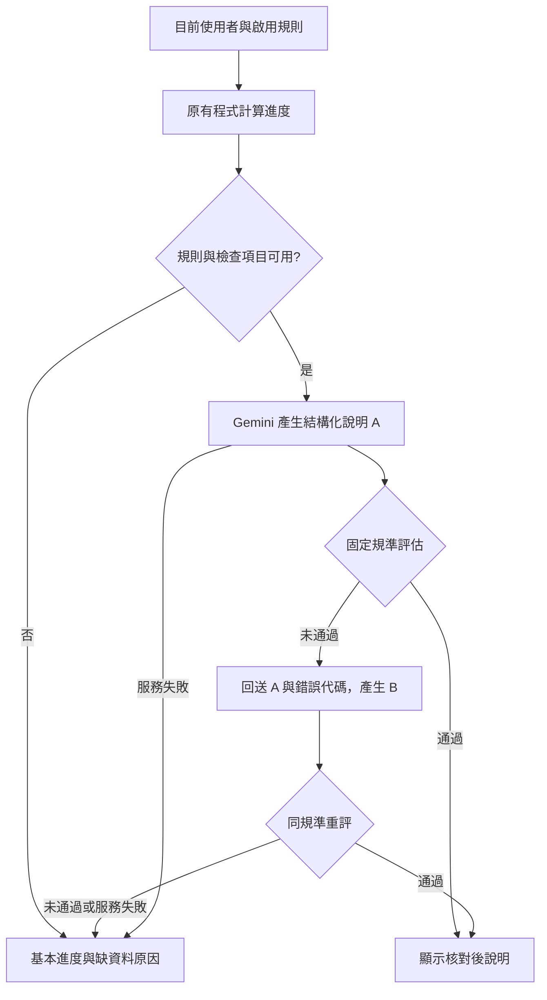

# Week 06 — Prompt Chaining Workflow Increment

## 一句話交付

我們在原專案的「智慧複習排程預覽」子流程，用 Prompt chaining 修正「模型抽取結果若未檢查就可能直接進 scheduler」的控制問題；程式差異、四條案例、前後比較、ADR 與證據索引都已放進原 repo。

## 原題目與業務終點

原題目仍是「學生個人安排系統」。本週只改智慧學習的一段：

    使用者自然語言
        ↓
    Gemini 抽取排程條件
        ↓
    deterministic Gate
        ├─ reject → STOP
        ↓ pass
    preview_study_plan
        ↓
    Gemini 摘要
        ↓
    answer_ready

業務終點仍是 read-only 複習排程預覽。本 workflow 不寫入 study session、不改畢業規則，也不替換整套 agent。

## 為什麼選 Prompt chaining

這一段的後一步依賴前一步：scheduler 只能吃通過 Gate 的結構化資料，摘要也只能使用實際 tool result。候選因此把抽取、Gate、tool 與摘要拆成可觀察階段。

核心斷言：Gate reject 後，preview tool 與 summary 都必須是 0 次。

## 程式入口

- backend/week06_chaining.py：workflow 與 Gate。
- week06/gemini_client.py：真實 Gemini extraction／summary client。
- week06/live_chaining.py：正常主流程 Live runner。
- tests/test_week06_chaining.py：本週四條控制測試。
- week06/run_acceptance.py：同 fixture baseline／candidate 比較。
- week06/evidence/offline_comparison.json：CI 後提交的清理證據。

## 實測結果

Implementation SHA：0fb360c4b98ff9fe59aac31dc7ac499d2cb10321

GitHub Actions run：39535318301

Job：119010509951

Artifact：12316908293

完整 regression：23 passed, 1 xfailed。

Offline comparison：offline_all_pass=true。

四項離線控制檢查：
- 原 preview 與 candidate preview 完全相同：PASS
- 空輸入在模型與工具前拒絕：PASS
- 注入 provider failure 有限停止且不假造結果：PASS
- Gate reject 後 preview tool=0、summary=0：PASS

原本既有的一項 xfail 仍是先前保留的 known failure，不是 Week 06 新退步。

## 真實 Gemini 狀態

課堂要求正常主流程必須是真的 Gemini，fixture 不能替代。因此目前誠實標示：

- Case 1 正常主流程：LIVE_NOT_RUN
- Case 2 非法輸入：PASS_OFFLINE
- Case 3 Provider failure：PASS_INJECTED
- Case 4 Chaining Gate 邊界：PASS_OFFLINE

真實 Gemini runner：

    $env:GEMINI_API_KEY="你的私人 key"
    $env:GEMINI_MODEL="你的可用模型"
    py -m week06.live_chaining

沒有 API key 時不宣稱 LIVE_PASS，也不要把 .env、API key、ADC JSON、token 或個資提交到 repo。

排程前後比較見 AGENTIC-COMPARISON.md，架構決策見 ADR.md，證據索引見 EVIDENCE_INDEX.md；畢業功能比較另見 comparison.md。


---

## 前端功能線文件（合併保留）

# Week 06：智慧學習 Prompt Chaining Workflow

## 一句話交付

我們在原專案的「智慧學習」子流程，用 Prompt chaining workflow 修正排程、安全檢查與 Agent 說明之間沒有明確交接與停止證據的問題，證據在本文件、[`adr-001-study-plan-prompt-chaining.md`](adr-001-study-plan-prompt-chaining.md) 與自動測試。

## 範圍與版本

- 原題目：學生個人安排系統。
- 原使用者故事：學生設定考試日期、複習時數與可用時段，系統避開課程及私人行程產生學習計畫。
- 業務終點：產生可檢查、可手動調整的複習時段與說明，不自動寫入校務系統。
- Baseline SHA：[`0128b36`](https://github.com/Yum1k020/Make_NUTN_Better/commit/0128b36)。
- Candidate SHA（程式與測試）：[`f572397`](https://github.com/Yum1k020/Make_NUTN_Better/commit/f572397)。
- 本週只改「智慧學習」的一段子流程，不更換 React、Vite、OpenAI Agents SDK 或其他功能。

## 原流程與缺口

Baseline 會依序驗證請求、產生規則排程、呼叫 Agent，但沒有一個可觀察的 workflow 契約：

- 排程完成後，沒有獨立 Gate 重新核對日期、允許時段、衝突、時數加總與識別碼。
- 失敗時只看到一般錯誤，無法從 UI 辨識停在哪一階段。
- 無法直接證明 Gate 拒絕後 Agent 階段是 0 次。

## 選定 Workflow

採用 **Prompt chaining**，因為這段流程有固定的相依順序，後一階段必須使用前一階段已驗證的輸出：

```text
需求驗證
  -> 規則排程
  -> 衝突與完整性 Gate
  -> Agent 說明
```

| 階段              | 輸入                                 | 輸出                                               | 放行條件                        |
| ----------------- | ------------------------------------ | -------------------------------------------------- | ------------------------------- |
| 需求驗證          | 日期、時數、可用時段、課程與私人行程 | 正規化請求                                         | Schema 無問題，考試日晚於起始日 |
| 規則排程          | 正規化請求                           | `sessions`、`scheduledMinutes`、`remainingMinutes` | 規則引擎成功回傳                |
| 衝突與完整性 Gate | 請求與排程                           | 問題清單                                           | 0 項問題                        |
| Agent 說明        | Gate 通過的排程                      | structured output 說明                             | Provider 成功且輸出通過 schema  |

## Scaffold 與強制停止

| Stop reason          | 停止點            | 後續行為                       |
| -------------------- | ----------------- | ------------------------------ |
| `INVALID_REQUEST`    | 需求驗證          | 不執行排程與 Agent             |
| `RULE_ENGINE_FAILED` | 規則排程          | 不進入 Gate 與 Agent           |
| `PLAN_GATE_REJECTED` | 衝突與完整性 Gate | 不呼叫 Agent，不採用不安全排程 |
| `AGENT_STAGE_FAILED` | Agent 說明        | 有限停止，前端保留原本規則排程 |

Workflow 每次只允許一次 Agent 說明嘗試，不在本層無限重試。Trace 只保留階段、狀態、計數、公開 stop reason 與 run ID；不保存私人行程內容、API key、完整 prompt 或模型內部推理。

## 四條必備案例

| #   | 案例               | 預期                                                   | 實際                                             | 狀態與證據                                                             |
| --- | ------------------ | ------------------------------------------------------ | ------------------------------------------------ | ---------------------------------------------------------------------- |
| 1   | 正常主流程         | 真實 Agent 呼叫成功，四階段通過，保留 360 分鐘規則排程 | 3 個時段、360 分鐘、尚缺 0；四階段皆 `completed` | `LIVE_PASS`；2026-10-21；`week06-697e30d1-b978-47ba-b6a4-27b23aa55d52` |
| 2   | 非法輸入           | 拒絕同日起始與考試日，不沿用舊結果                     | `INVALID_REQUEST`；planner 0 次、Agent 0 次      | `TEST_PASS`；`week06 case 2`                                           |
| 3   | Provider 失敗      | 只嘗試一次，如實停止並保留原規則結果                   | 注入失敗後回報 `AGENT_STAGE_FAILED`，attempt 1   | `TEST_PASS`；`week06 case 3`；注入測試與實測分開                       |
| 4   | Chaining Gate 邊界 | 排程與課程重疊時 Gate 拒絕，Agent 0 次                 | `PLAN_GATE_REJECTED`；下游 0 次                  | `TEST_PASS`；`week06 case 4`                                           |

本流程沒有建立保留、付款或遠端寫入，因此不需要第 5 條寫入重送案例。

## Before / After 比較

| 比較欄位       | Baseline `0128b36`                                  | Candidate `f572397`                                                       |
| -------------- | --------------------------------------------------- | ------------------------------------------------------------------------- |
| 版本與控制     | Schema 與規則函式存在，但沒有統一 workflow trace    | 四階段 Prompt chaining，階段契約與 Gate 可檢查                            |
| 固定任務與終點 | 6 小時複習規劃，排程可調整                          | 相同輸入、fixture、規則引擎與業務終點                                     |
| 成功與安全     | Baseline 測試 12/12 通過；Agent 失敗時前端 fallback | Candidate 測試 16/16 通過；Gate 拒絕後 Agent 0 次；真實 smoke `LIVE_PASS` |
| 呼叫與代價     | 未量測 token 與延遲                                 | 一次 Agent 階段嘗試；CLI 端到端約 17 秒；token usage 未取得               |
| 證據           | 原規則測試與 Week 04 文件                           | workflow run ID、四階段 trace、四條案例與 UI                              |

本次不宣稱省 token、省費用或提高排程正確率；改善的是「控制邊界與可觀察證據」。

## 程式與執行

- `frontend/server/studyPlanWorkflow.js`：需求 schema、四階段 workflow、Gate、stop reason 與安全 trace。
- `frontend/server/studyAgent.js`：把 Agents SDK 說明放在 Gate 之後。
- `frontend/server/studyAgentMiddleware.js`：將公開錯誤碼與 workflow trace 回傳給前端。
- `frontend/src/components/StudyPlanner.jsx`：顯示階段、結果、stop reason 與 run ID。
- `frontend/tests/studyPlanWorkflow.test.js`：四條必備案例。

```bash
cd frontend
npm test
npm run build
npm run format:check
npm run agent:smoke
```

## 清理後證據索引

| 證據階段    | 位置                                                       | 可核對內容                                |
| ----------- | ---------------------------------------------------------- | ----------------------------------------- |
| 請求        | `studyPlanWorkflow.js` 的 `studyPlanRequestSchema`         | 只接受規劃需要的欄位                      |
| Actual call | `studyAgent.js` 的 `runStudyPlanWorkflow()` / `runAgent()` | Agent 只在 Gate 通過後執行                |
| 檢查／確認  | `verifyStudyPlan()`                                        | 日期、時段、衝突、時數、重複 ID           |
| 結果        | `workflow.stages` 與 `stopReason`                          | 階段成功、拒絕或失敗                      |
| 回送        | `studyAgentMiddleware.js` 與 `studyAgentClient.js`         | 成功或安全錯誤格式                        |
| 摘要        | `StudyPlanner.jsx` 的 workflow trace                       | 畫面可見的階段、計數、stop reason、run ID |

## 已知問題與補驗證

- `LIVE_PASS`：2026-10-21 使用合成課名、固定日期與空的私人行程完成一次真實 OpenAI Agent 請求。
- 這個 `LIVE_PASS` 只證明當時本機開發環境與 API 可用，不證明正式部署、校務系統或長期可用性。
- Vite middleware 仍是本機原型；正式部署前要移至受控後端。
- 當網路、key 或 provider 失敗時，UI 會保留本機規則排程；不把該情況說成 Agent 完成。
- `.env.local`、API key、token、個資與模型內部推理均不在 Git 交付範圍。


---

## 畢業功能線文件（原始分支內容）

# Week 06｜畢業缺項說明與評估修正

我們在原專案的「畢業進度 → 缺項說明」子流程，使用 **Evaluator–optimizer** 攔下數字、狀態與來源不符的說明；最多修正一次，同規準重評，未通過就回退基本進度。

**完成狀態：程式、前端串接、離線四類案例、前後比較與 ADR 已提供。真實 Gemini 正常流程為 `LIVE_NOT_RUN`：本次環境未提供 `GEMINI_API_KEY` 與 `GEMINI_MODEL`。這項作業驗收仍待補做，不把 fixture 當 live。**

## 範圍與版本

- 原題目、原 repo、原使用者故事；畢業判定維持唯讀。
- 基線：`codex/week05-graduation-langgraph`，`13be93782ef44e08886f86afffedd7f8fc72333d`。
- 新分支：`codex/week06-graduation-explanations`。最後提交以 GitHub 分支 HEAD 為準；可執行來源版本與雜湊記在證據中。
- 沿用後端 `nutn-csie-115-mvp-v1`；**沒有遷移到目標 v2**。不猜共同認列範圍、未知課程對照或當期開課。
- 不改排程、確認／寫入、其他 agent、規則資料庫結構、共用套件鎖定檔。
- 原系統為固定測試使用者，沒有正式登入；不宣稱完成正式學生隔離與部署。

## 執行

以下從 repo 根目錄執行；Windows 使用 Python 3.12 並啟用 UTF-8。若使用既有虛擬環境，可直接沿用。

```powershell
py -3.12 -m venv .venv
.venv/Scripts/python.exe -m pip install -r backend/requirements-dev.lock.txt -r backend/requirements-framework.lock.txt tzdata
$env:PYTHONUTF8='1'
$env:GRADUATION_ENGINE='langgraph'
$env:GRADUATION_ALLOWED_ORIGINS='http://127.0.0.1:5173,http://localhost:5173'
.venv/Scripts/python.exe -m flask --app backend.app init-db
.venv/Scripts/python.exe -m flask --app backend.app run --host 127.0.0.1 --port 5000
```

另一個終端啟動前端：

```powershell
cd frontend
npm ci
node node_modules/vite/bin/vite.js --config vite.graduation.config.js --host 127.0.0.1
```

開啟終端顯示的網址，選「畢業進度」。專用 config 延伸當前分支的原 config，保留既有 agent middleware，只代理 `/api/v1` 至 `127.0.0.1:5000`。若 Vite 使用其他埠，請明確設定該來源；部署時移除本機來源，透過同源反向代理提供 `/api/v1`。未允許的 Origin 或 cross-site 請求仍拒絕，沒有開放 CORS。

若尚未設定系所／年度，API 合法地回傳「待確認、缺規則」，不能用示範數字冒充進度。可用 Swagger 的 `/api/v1/me` PATCH 設定 `department_id=dept-nutn-csie`、`admission_year=115`、`current_semester_id=semester-115-1`；不自動替使用者改資料。

### Gemini 設定與 live 補驗證

在後端終端的環境變數設定 `GEMINI_API_KEY` 與你帳號可用的 `GEMINI_MODEL`，再啟動後端。不要把金鑰寫入程式、前端、文件或提交。

```powershell
.venv/Scripts/python.exe backend/week06_acceptance.py --live
```

此指令只建立 `.cache/week06/` 下的**合成資料庫**，透過真實 Gemini 接頭執行正常流程，產生 `evidence/live.json`。無設定寫 `LIVE_NOT_RUN`；真實失敗或規準不通過寫 `LIVE_FAIL`；真實呼叫且同規準通過才寫 `LIVE_PASS`。失敗注入仍另外標示 injected。

`GEMINI_MODEL` 必須明確設定，不預設替使用者選擇模型與費用。每次使用者按「產生說明」最多兩次模型請求，每次網路 I/O timeout 25 秒，沒有自動網路重試。回應最多 256 KiB，生成上限 8192 tokens；未提供的 token 用量視為未取得。

### 可重現的離線展示

```powershell
.venv/Scripts/python.exe backend/week06_acceptance.py
.venv/Scripts/python.exe backend/week06_acceptance.py --serve-fixture
```

第二個指令以合成資料與明示 fixture 啟動 `127.0.0.1:5000`；A 故意缺來源且錯寫學分，B 依回饋修正，用於觀察控制流程，**不是模型自然犯錯或真實 Gemini 的證據**。只在測試模式允許注入 provider，正式 app 不讀取此測試接頭。

## 流程與資訊契約



- **模型決策**：依證據排列所有檢查項目、提出對應 action 的結構化說明；修正回饋由模型消化。
- **程式控制**：來源核對、數字／null／狀態、完整覆蓋、可用 action、是否接受、最多兩稿及回退。
- **送入模型**：規則版本、總學分、整體狀態，各 check 的 ID、名稱、門檻、採計值、缺額、單位與狀態。使用者已明確允許將此去識別摘要送往 Google Gemini。
- **不送入模型**：姓名、學號、user_id、逐筆修課、成績、原始文件、登入憑證及寫入工具。
- **輸出**：結構化 claims；每一項必須引用 `rule_set_id:check_id`。前端顯示的文字由已核對的 clauses 轉成中文，避免未核對自由文字繞過規準。
- **未知**：`null` 與 0 分開；規劃／修習中不加入已得學分；不聲稱校方認證或保證開課。

開工契約、驗收與停止條件見 [contract.md](contract.md)，設計取捨見 [ADR.md](ADR.md)。

## API 與前端

- 原 `GET /api/v1/graduation-progress` 不變；不會為了載入頁面呼叫模型。
- 新 `POST /api/v1/graduation-explanation`，不接受 query 或 request body。後端重新讀目前使用者的進度，再釋放讀取交易後呼叫模型；不採用瀏覽器提供的學分。
- 200：`data.progress` 與 `data.workflow`。workflow 包含 `run_id`、evidence／hash、規準版本、A/B、錯誤、呼叫次數、可取得用量、停止原因及說明。
- provider 失敗仍回 200 與 `status=fallback`，基本進度可用；資料庫／規則損壞回 500，非法輸入 422，其他網站觸發回 403，均不呼叫模型。
- 前端只替換 `GraduationProgress.jsx`，新增專用 CSS、client 與 Vite config；不修改 App、共用 styles、原 Vite config 或其他頁面。
- 修課規劃頁仍使用原本本機示範資料，畢業頁清楚標示後端規劃紀錄與本機示範的界線；本次不順帶重構整個系統。

## 作業驗收與證據

| 必備案例 | 預期 | 實際證據／狀態 |
|---|---|---|
| 正常主流程 | 真實 Gemini，工具計算回送，保留原終點 | `live.json`：LIVE_NOT_RUN，待金鑰與模型；fixture 正常流程另外記錄 |
| 非法輸入 | 入口拒絕，下游模型 0 次，資料庫不變 | `offline.json`、`acceptance.json` |
| Provider／工具失敗 | 有限停止，真實錯誤狀態，保留基本進度 | provider timeout／503 與 checksum 損壞測試；清楚標記注入 |
| workflow 邊界 | A 錯誤會拒絕，B 用同規準；仍錯就停止 | A/B、錯誤來源／學分、REVISION_LIMIT 測試與 UI 圖 |

無業務寫入，因此第 5 條寫入冪等不適用；另有重複查詢不改資料庫測試。模型重送會產生新的請求與用量，不宣稱模型請求冪等。

- [證據索引與 before/after](comparison.md)
- [離線測試完整紀錄](evidence/offline.json)
- [合成驗收與 A/B](evidence/acceptance.json)
- [原始基線 checkout 實測](evidence/baseline-original.json)
- [真實驗收狀態](evidence/live.json)
- [回歸摘要](evidence/regression-summary.json)
- [分支合併檢查](evidence/merge-checks.json)
- [瀏覽器畫面（合成 fixture）](evidence/ui-fixture.svg)

## 分支整合與回退

本次從畢業專用 week05 分支延伸，只推新分支，不修改其他遠端分支。相容性以 `merge-checks.json` 中當時的確切 SHA 為準；既有分支之間原先的衝突與本次新增衝突分開記錄。後續其他分支再修改同一檔案，仍可能需要重新檢查。

撤回本次程式提交即可回復舊頁面與 API；沒有資料庫遷移或資料寫入需要逆轉。既有 `GRADUATION_ENGINE=legacy` 回退仍保留，新說明 API 也能讀 legacy 的相同結果。

已知限制：缺真實 Gemini 驗收；原規則對照資料未齊；v2 未導入；正式登入未實作。Windows 原有 3 條 POSIX pipe 測試不能直接執行，其餘測試與實際瀏覽器 HTTP 分開記錄。既有前端 14 個未改檔案未通過全域格式檢查，本次變更檔案個別格式檢查通過；沒有為格式化擴大衝突範圍。
