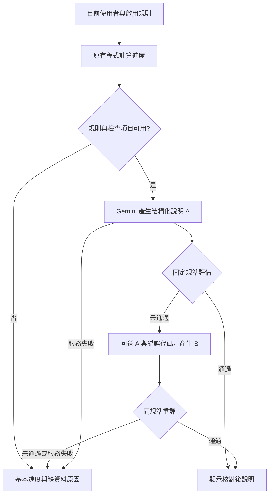

# Week 06｜畢業缺項說明與評估修正

我們在原專案的「畢業進度 → 缺項說明」子流程，使用 **Evaluator–optimizer** 攔下數字、狀態與來源不符的說明；最多修正一次，同規準重評，未通過就回退基本進度。

**完成狀態：程式、前端串接、離線四類案例、前後比較與 ADR 已提供。真實 Gemini 正常流程為 `LIVE_NOT_RUN`：本次環境未提供 `GEMINI_API_KEY` 與 `GEMINI_MODEL`。這項作業驗收仍待補做，不把 fixture 當 live。**

## 範圍與版本

- 原題目、原 repo、原使用者故事；畢業判定維持唯讀。
- 基線：`codex/week05-graduation-langgraph`，`13be93782ef44e08886f86afffedd7f8fc72333d`。
- 新分支：`codex/week06-graduation-explanations`。最後提交以 GitHub 分支 HEAD 為準；可執行來源版本與雜湊記在證據中。
- 沿用後端 `nutn-csie-115-mvp-v1`；**沒有遷移到目標 v2**。不猜共同認列範圍、未知課程對照或當期開課。
- 不改排程、確認／寫入、其他 agent、規則資料庫結構、共用套件鎖定檔。
- 原系統為固定測試使用者，沒有正式登入；不宣稱完成正式學生隔離與部署。

## 執行

以下從 repo 根目錄執行；Windows 使用 Python 3.12 並啟用 UTF-8。若使用既有虛擬環境，可直接沿用。

```powershell
py -3.12 -m venv .venv
.venv/Scripts/python.exe -m pip install -r backend/requirements-dev.lock.txt -r backend/requirements-framework.lock.txt tzdata
$env:PYTHONUTF8='1'
$env:GRADUATION_ENGINE='langgraph'
$env:GRADUATION_ALLOWED_ORIGINS='http://127.0.0.1:5173,http://localhost:5173'
.venv/Scripts/python.exe -m flask --app backend.app init-db
.venv/Scripts/python.exe -m flask --app backend.app run --host 127.0.0.1 --port 5000
```

另一個終端啟動前端：

```powershell
cd frontend
npm ci
node node_modules/vite/bin/vite.js --config vite.graduation.config.js --host 127.0.0.1
```

開啟終端顯示的網址，選「畢業進度」。專用 config 延伸當前分支的原 config，保留既有 agent middleware，只代理 `/api/v1` 至 `127.0.0.1:5000`。若 Vite 使用其他埠，請明確設定該來源；部署時移除本機來源，透過同源反向代理提供 `/api/v1`。未允許的 Origin 或 cross-site 請求仍拒絕，沒有開放 CORS。

若尚未設定系所／年度，API 合法地回傳「待確認、缺規則」，不能用示範數字冒充進度。可用 Swagger 的 `/api/v1/me` PATCH 設定 `department_id=dept-nutn-csie`、`admission_year=115`、`current_semester_id=semester-115-1`；不自動替使用者改資料。

### Gemini 設定與 live 補驗證

在後端終端的環境變數設定 `GEMINI_API_KEY` 與你帳號可用的 `GEMINI_MODEL`，再啟動後端。不要把金鑰寫入程式、前端、文件或提交。

```powershell
.venv/Scripts/python.exe backend/week06_acceptance.py --live
```

此指令只建立 `.cache/week06/` 下的**合成資料庫**，透過真實 Gemini 接頭執行正常流程，產生 `evidence/live.json`。無設定寫 `LIVE_NOT_RUN`；真實失敗或規準不通過寫 `LIVE_FAIL`；真實呼叫且同規準通過才寫 `LIVE_PASS`。失敗注入仍另外標示 injected。

`GEMINI_MODEL` 必須明確設定，不預設替使用者選擇模型與費用。每次使用者按「產生說明」最多兩次模型請求，每次網路 I/O timeout 25 秒，沒有自動網路重試。回應最多 256 KiB，生成上限 8192 tokens；未提供的 token 用量視為未取得。

### 可重現的離線展示

```powershell
.venv/Scripts/python.exe backend/week06_acceptance.py
.venv/Scripts/python.exe backend/week06_acceptance.py --serve-fixture
```

第二個指令以合成資料與明示 fixture 啟動 `127.0.0.1:5000`；A 故意缺來源且錯寫學分，B 依回饋修正，用於觀察控制流程，**不是模型自然犯錯或真實 Gemini 的證據**。只在測試模式允許注入 provider，正式 app 不讀取此測試接頭。

## 流程與資訊契約



- **模型決策**：依證據排列所有檢查項目、提出對應 action 的結構化說明；修正回饋由模型消化。
- **程式控制**：來源核對、數字／null／狀態、完整覆蓋、可用 action、是否接受、最多兩稿及回退。
- **送入模型**：規則版本、總學分、整體狀態，各 check 的 ID、名稱、門檻、採計值、缺額、單位與狀態。使用者已明確允許將此去識別摘要送往 Google Gemini。
- **不送入模型**：姓名、學號、user_id、逐筆修課、成績、原始文件、登入憑證及寫入工具。
- **輸出**：結構化 claims；每一項必須引用 `rule_set_id:check_id`。前端顯示的文字由已核對的 clauses 轉成中文，避免未核對自由文字繞過規準。
- **未知**：`null` 與 0 分開；規劃／修習中不加入已得學分；不聲稱校方認證或保證開課。

開工契約、驗收與停止條件見 [contract.md](contract.md)，設計取捨見 [ADR.md](ADR.md)。

## API 與前端

- 原 `GET /api/v1/graduation-progress` 不變；不會為了載入頁面呼叫模型。
- 新 `POST /api/v1/graduation-explanation`，不接受 query 或 request body。後端重新讀目前使用者的進度，再釋放讀取交易後呼叫模型；不採用瀏覽器提供的學分。
- 200：`data.progress` 與 `data.workflow`。workflow 包含 `run_id`、evidence／hash、規準版本、A/B、錯誤、呼叫次數、可取得用量、停止原因及說明。
- provider 失敗仍回 200 與 `status=fallback`，基本進度可用；資料庫／規則損壞回 500，非法輸入 422，其他網站觸發回 403，均不呼叫模型。
- 前端只替換 `GraduationProgress.jsx`，新增專用 CSS、client 與 Vite config；不修改 App、共用 styles、原 Vite config 或其他頁面。
- 修課規劃頁仍使用原本本機示範資料，畢業頁清楚標示後端規劃紀錄與本機示範的界線；本次不順帶重構整個系統。

## 作業驗收與證據

| 必備案例 | 預期 | 實際證據／狀態 |
|---|---|---|
| 正常主流程 | 真實 Gemini，工具計算回送，保留原終點 | `live.json`：LIVE_NOT_RUN，待金鑰與模型；fixture 正常流程另外記錄 |
| 非法輸入 | 入口拒絕，下游模型 0 次，資料庫不變 | `offline.json`、`acceptance.json` |
| Provider／工具失敗 | 有限停止，真實錯誤狀態，保留基本進度 | provider timeout／503 與 checksum 損壞測試；清楚標記注入 |
| workflow 邊界 | A 錯誤會拒絕，B 用同規準；仍錯就停止 | A/B、錯誤來源／學分、REVISION_LIMIT 測試與 UI 圖 |

無業務寫入，因此第 5 條寫入冪等不適用；另有重複查詢不改資料庫測試。模型重送會產生新的請求與用量，不宣稱模型請求冪等。

- [證據索引與 before/after](comparison.md)
- [離線測試完整紀錄](evidence/offline.json)
- [合成驗收與 A/B](evidence/acceptance.json)
- [原始基線 checkout 實測](evidence/baseline-original.json)
- [真實驗收狀態](evidence/live.json)
- [回歸摘要](evidence/regression-summary.json)
- [分支合併檢查](evidence/merge-checks.json)
- [瀏覽器畫面（合成 fixture）](evidence/ui-fixture.svg)

## 分支整合與回退

本次從畢業專用 week05 分支延伸，只推新分支，不修改其他遠端分支。相容性以 `merge-checks.json` 中當時的確切 SHA 為準；既有分支之間原先的衝突與本次新增衝突分開記錄。後續其他分支再修改同一檔案，仍可能需要重新檢查。

撤回本次程式提交即可回復舊頁面與 API；沒有資料庫遷移或資料寫入需要逆轉。既有 `GRADUATION_ENGINE=legacy` 回退仍保留，新說明 API 也能讀 legacy 的相同結果。

已知限制：缺真實 Gemini 驗收；原規則對照資料未齊；v2 未導入；正式登入未實作。Windows 原有 3 條 POSIX pipe 測試不能直接執行，其餘測試與實際瀏覽器 HTTP 分開記錄。既有前端 14 個未改檔案未通過全域格式檢查，本次變更檔案個別格式檢查通過；沒有為格式化擴大衝突範圍。
