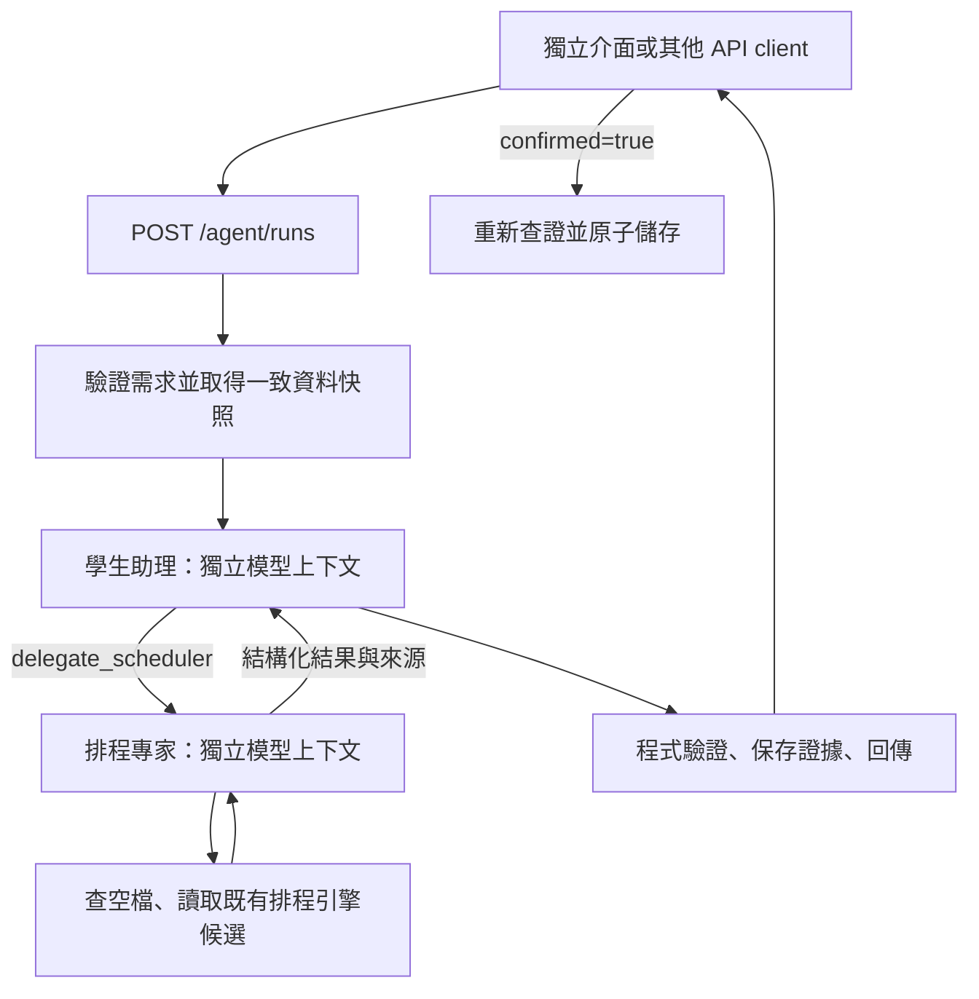

# Week 08：複習規劃 Agent API 與獨立驗證介面

新增可重用的 `/api/v1/agent` API，透過學生助理委派排程專家，呼叫既有排程引擎並交回結果。獨立介面位於 `/agent-lab`，不修改 `frontend/` 的 React 原型、原本 `/` → `/docs` 的入口或既有 API 契約。

本版採結構化需求表單，**尚未實作自由文字日期／需求解析**。提供 `offline` 固定流程驗證與 `openai` 真實模型路徑；兩者的呼叫量與事件分開標示。

## 啟動

在儲存庫根目錄，已建好環境時最快的獨立啟動方式：

```sh
./scripts/run-agent-lab.sh
```

此指令使用獨立 `backend/instance/agent-lab.sqlite3` 與 5051 port，自動初始化，不連動原本開發資料庫；仍可透過 ME_DATABASE／PORT 覆寫。

若要和既有後端資料共用，使用原啟動流程：

```sh
# 第一次安裝需要 Python 3.12+；已建好 .venv 可略過安裝。
PYTHON_BIN=python3.12 ./scripts/setup-backend.sh

# 可重複執行：增加 agent_runs 表，不覆寫既有資料。
./scripts/init-backend-db.sh
PORT=5051 ./scripts/run-backend.sh
```

- 獨立工作台：<http://127.0.0.1:5051/agent-lab>
- Swagger：<http://127.0.0.1:5051/docs>，搜尋 `Study agents`。
- OpenAPI：<http://127.0.0.1:5051/openapi.json>
- 本機資料庫：`backend/instance/profile.sqlite3`；可用 `ME_DATABASE` 指定其他檔案，初始化與啟動必須一致。
- 本次已建立專案 `.venv`；執行依賴未新增第三方套件。OpenAI 傳輸使用 Python 標準函式庫。

若希望所有展示與儲存操作也使用獨立資料庫：

```sh
export ME_DATABASE="$PWD/backend/instance/agent-lab.sqlite3"
./scripts/init-backend-db.sh
PORT=5051 ./scripts/run-backend.sh
```

此資料庫仍使用既有初始化的合成課程目錄；不會自行複製其他資料庫或前端 localStorage 的課表。

## OpenAI 設定

模型名稱由部署者指定，必須為帳號可用、支援 Responses API function calling 的模型。金鑰只讀取後端環境變數，不經前端、不進入 trace、不寫入儲存庫。這個專案沒有自動載入 `.env` 的依賴，單純建立 `.env` 不會生效。

例如在 zsh 終端機安全輸入：

```sh
read -rs 'OPENAI_API_KEY?OpenAI API key: '
export OPENAI_API_KEY
printf '\n'
read 'OPENAI_MODEL?可用的 OpenAI model ID: '
export OPENAI_MODEL
PORT=5051 ./scripts/run-backend.sh
```

若使用獨立資料庫，最後一行改為 `./scripts/run-agent-lab.sh`。

重啟後 `/api/v1/agent/config` 的 `openai.configured` 應為 `true`，介面才開放 OpenAI 選項。這只代表環境變數存在，**不代表金鑰、模型權限或額度已通過真實連線驗證**。

對照 [OpenAI 官方 function calling 文件](https://developers.openai.com/api/docs/guides/function-calling) 與 [Responses API reference](https://developers.openai.com/api/reference/resources/responses/methods/create)：本版使用嚴格工具 schema、`parallel_tool_calls=false`、`function_call_output` 回送、`store=false`。加密 reasoning 僅留在單次請求的記憶體中供後續回合使用，不存入公開紀錄。

本次沒有可用的 `OPENAI_API_KEY`，因此沒有發出真實 OpenAI 請求；不能把離線或 stub 測試當作模型品質驗證。

## 操作介面

1. 選擇「六小時範例」或「時數不足範例」，或修改課程、日期、時數、允許星期與時段。
2. 選擇離線／OpenAI、單 Agent／多 Agent，按「產生並驗證」。
3. 在「複習安排」檢查候選時段與尚缺時數。
4. 在「協作紀錄」查看角色帳本、工具權限檢查與工具結果。
5. 在「驗證與來源」按「重新查證」，檢查現在的課表是否仍符合候選。
6. 在「API / JSON」查看本次請求、完整結果、下載證據。
7. 只有按「確認儲存這份計畫」才會建立後端 study-plan 與 sessions。產生、讀取與重新查證均不改動既有行程。

範例日期固定為 2026-11-16～2026-11-20，方便重現。實際使用請自行調整日期；若同週已存複習或行程，結果會不同。

## API 契約

所有路徑前綴為 `/api/v1/agent`。JSON 請求必須使用 `Content-Type: application/json`；拒絕額外欄位與未支援的 query。身份沿用固定 `user-demo-001`，**尚無正式登入、多使用者授權或公開服務能力**。

| 方法與路徑 | 輸入 | 成功輸出／副作用 |
| --- | --- | --- |
| `GET /config` | 無 | 角色、上限、模型名稱與設定狀態；不回傳金鑰 |
| `GET /examples` | 無 | 兩個固定請求範例；不建立課表或計畫 |
| `POST /runs` | `provider`、`architecture`、`plan` | 201 + 完整 run；保存執行證據，不儲存排程 |
| `GET /runs` | 無 | 最近 20 筆本人 run 摘要，依建立時間倒序 |
| `GET /runs/{run_id}` | URL ID | 完整歷史 run；其中 verification 是當次生成時的檢查 |
| `POST /runs/{run_id}/verify` | **沒有 body** | 200 + 以目前資料重新計算的 verification；不改寫原始證據 |
| `POST /runs/{run_id}/commit` | `{"confirmed":true}` | 首次 201；同 run 重送 200，不重複新增計畫 |

### 產生候選

```json
{
  "provider": "offline",
  "architecture": "multi",
  "plan": {
    "course_id": "course-demo-001",
    "start_date": "2026-11-16",
    "exam_date": "2026-11-20",
    "target_minutes": 360,
    "session_minutes": 60,
    "allowed_windows": [
      {"weekday": 1, "start_time": "19:00", "end_time": "21:00"},
      {"weekday": 2, "start_time": "19:00", "end_time": "21:00"},
      {"weekday": 3, "start_time": "19:00", "end_time": "21:00"}
    ]
  }
}
```

另提供同內容的 [request-example.json](request-example.json)，可直接使用：

```sh
curl -sS http://127.0.0.1:5051/api/v1/agent/runs \
  -H 'Content-Type: application/json' \
  --data-binary @docs/week08/request-example.json
```

`provider` 為 `offline` 或 `openai`；`architecture` 為 `single` 或 `multi`。本版每次產生新草稿，不接受指定既有 plan_id 或 exam_task_id。

`plan` 所有範例欄位皆必填。日期區間 1～60 天，考試日不安排複習；目標為 1～14400 整數分鐘、每次 15～240 整數分鐘；每週視窗 1～28 個，weekday 1 為週一、7 為週日，同一天結束時間須晚於開始時間。時區固定 Asia/Taipei，輸出 ISO 8601 帶 `+08:00`。

### 結果與證據

回應使用 `{"data": ...}`。`POST /runs` 的 201 表示執行紀錄已建立，不保證規劃成功；呼叫端必須檢查 `data.status`、`verification.passed`，並查看不足時數。

| 欄位 | 說明 |
| --- | --- |
| `run_id`, `created_at` | UUID、建立時間；可持久化讀取 |
| `status` | `completed` 已排滿、`partial` 時數不足、`failed` 流程失敗 |
| `request` | 完整且驗證過的結構化原需求 |
| `provider` | 實際模式、模型 ID；離線模型為 null |
| `snapshot_version`, `engine_version` | 課程／需求／忙碌時段快照 SHA-256、引擎契約版本 |
| `result` | 候選時段、已排／尚缺分鐘、來源 IDs；失敗為 null |
| `narration`, `narration_verified` | 模型說明或離線說明；自由文字沒有完整語意驗證，後者為 false |
| `final_role` | 最後回答者；multi 為 assistant，single 為 single |
| `ledger` | 子任務唯一 owner、status 與版本；由程式更新 |
| `messages` | 專家回傳給助理的成果與快照版本 |
| `events` | 可觀察的角色事件、工具結果與錯誤，不含模型內部思考 |
| `sources` | 來源 ID、原始課表快照與使用的排程引擎 |
| `metrics` | 真實模型請求數、離線回合數、已回報 tokens、用量是否完整、Agent 執行毫秒數 |
| `verification` | 生成後的程式驗證結果與檢查時間 |
| `commit` | 未儲存為 null；已儲存包含 plan_id、plan_version 與分鐘數 |
| `error` | 僅失敗時提供 code、message |

`result.candidates` 為 `{title, starts_at, ends_at}` 陣列；`scheduled_minutes + remaining_minutes = target_minutes`。結果可以是零個候選，此時不能 commit。`result.plan_id` 是候選使用的暫存 run ID，**不是已存計畫 ID**；只有 `commit.plan_id` 才是後端已建立的計畫。

已儲存的 plan/session 仍可透過原有 `/api/v1/study-plans` 與 sessions API 管理，這是日後接回原前端的整合點。

### 查證與儲存

```sh
# 將 RUN_ID 換成建立 run 回傳的 UUID。
curl -sS -X POST http://127.0.0.1:5051/api/v1/agent/runs/RUN_ID/verify

curl -sS -X POST http://127.0.0.1:5051/api/v1/agent/runs/RUN_ID/commit \
  -H 'Content-Type: application/json' --data '{"confirmed":true}'
```

確認儲存取得 SQLite 寫入交易後，重新驗證快照、時間衝突與來源；成功時原子建立 plan、sessions 並更新 commit 證據。失敗整筆回滾。並行確認同一 run 只會建立一次。

若資料已變動，回傳 409 `RUN_NOT_COMMITTABLE`；客戶端需重新產生，不可直接重試覆蓋。已儲存後重送 commit 只回傳原本 receipt，不代表目前計畫仍未被修改；要檢查當前狀態請呼叫 verify。已存計畫被修改或刪除時，verify 會失敗。

### 錯誤邊界

- HTTP 400：壞 JSON；415：錯誤 Content-Type；422：缺漏、非法值、額外欄位或未知課程。
- HTTP 404：找不到 run；409：無可儲存時段、過期資料或驗證失敗；503：OpenAI 環境變數未設定。
- 執行中的工具／模型錯誤：run 仍保存並回 201，但 `status=failed`，包含 `ROLE_TOOL_DENIED`、`UNGROUNDED_RESULT`、`SCHEDULE_INCOMPLETE`、`PROVIDER_TIMEOUT`、`PROVIDER_RATE_LIMIT` 等 code。
- 資料庫未初始化或其他內部錯誤回 500；請先 init-db。伺服器中途被終止不保證保存未完成 run。本版同步請求尚無背景恢復／取消機制。
- `model_calls` 計入已嘗試的網路呼叫。失敗或沒有 usage 的回應會令 `usage_complete=false`，未回報 tokens 不得當作零成本。

## 架構與角色契約



| 角色 | 工具白名單 | 上下文與責任 |
| --- | --- | --- |
| assistant | delegate_scheduler、finish | 原需求、課程、時區、快照版本；委派後取得專家結果並整合 |
| scheduler | get_availability、generate_schedule、finish | 必要需求與工具結果，不取得助理全部歷史；負責排程子任務 |
| single | get_availability、generate_schedule、finish | 同輸入同工具的單 Agent 比較基線 |

角色都不能呼叫寫入工具。助理最多委派一次；先取空檔再取候選，取得工具事實後才能 finish。回傳的分鐘數與來源 ID 必須精確符合工具。時段始終由既有程式計算，模型負責工具決策、交付與說明。

快照與候選在短暫的 SQLite 讀取交易內取得，之後釋放交易再進行網路請求；這避免模型等待期間鎖住資料庫。角色呼叫工具時讀取該次快照的結果，不重新混入不同版本資料。保存執行證據前會對照目前資料，commit 時再查一次。

停止界線：每角色最多 6 回合、全 run 最多 10 回合、120 秒執行預算、單次網路操作 timeout 最多 30 秒；不自動重試、不無限委派。120 秒會在呼叫前及回應後檢查；標準函式庫 socket timeout 不是精確的全流程硬中斷計時器。

## 驗證與證據

```sh
./scripts/test-backend.sh tests/test_agents.py -q --evidence=../docs/week08/test-evidence.json
./scripts/test-backend.sh -q --evidence=../docs/week08/regression-evidence.json
```

- [新增 API 測試證據](test-evidence.json)
- [完整後端回歸證據](regression-evidence.json)
- [真實 HTTP 與獨立工作台證據](http-smoke.json)
- [驗證結果與限制](VALIDATION.md)
- [設計取捨](ADR.md)

Baseline SHA：`efca82d4cfb00da9d7c9012fa2fa21d92719214f`。本次尚未提交，沒有虛構 candidate SHA；測試證據內的 source_sha256 記錄當時工作目錄的程式版本。

## 修改位置

- `backend/app/agent_api.py`：HTTP、快照、查證、冪等儲存、獨立 UI 路由。
- `backend/app/agent_engine.py`：角色迴圈、白名單、帳本、紀錄、有限停止。
- `backend/app/agent_provider.py`：OpenAI Responses 傳輸、環境變數、錯誤遮蔽。
- `backend/app/agent_openapi.py`：Swagger／OpenAPI 契約。
- `backend/app/agent_lab/`：獨立 HTML、CSS、JS，直接呼叫公開 API。
- `backend/app/__init__.py`、`db.py`：各增加兩行接入／初始化，不替換既有排程邏輯。
- `backend/tests/test_agents.py`：驗收與失敗路徑。

## 本版界線

尚無自由文字解析、畢業進度 Agent、正式登入、多使用者隔離、背景佇列或公開部署。原前端仍使用自己的 localStorage，這個 API 不讀取該資料。OpenAI 真實模型品質及用量仍需在設定金鑰與模型後驗證；工具事實可由程式核對，自由文字解釋須另外審閱。
